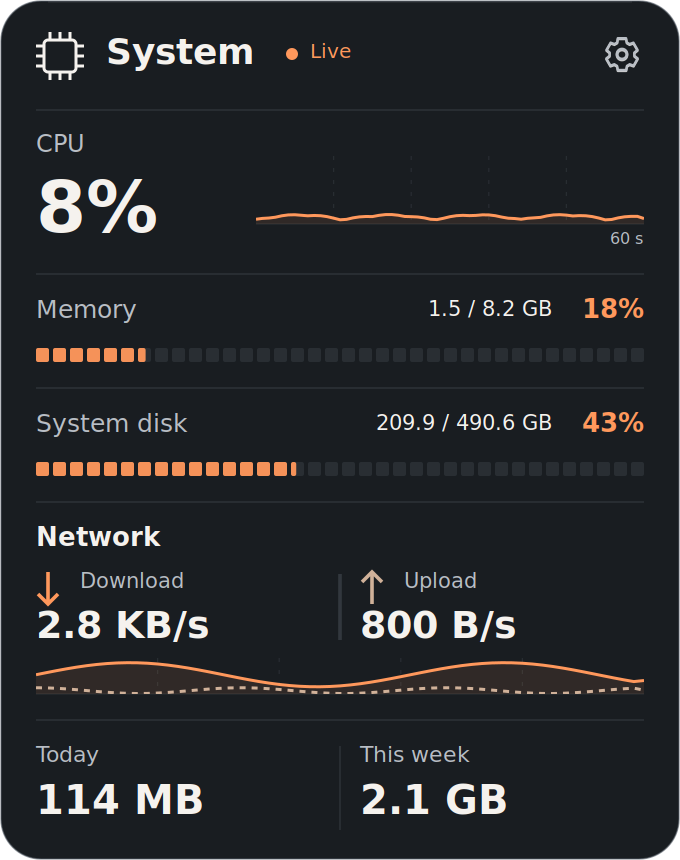
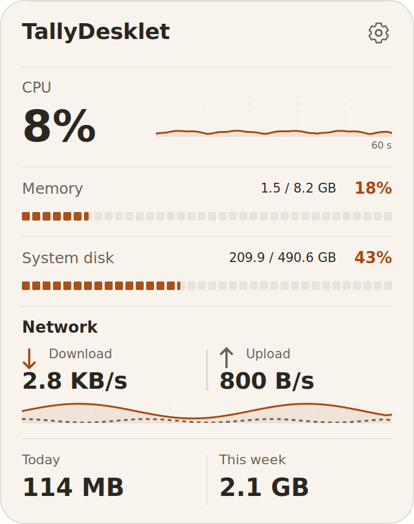

<p align="center">
  
</p>

<h1 align="center">TallyDesklet</h1>
<p align="center">A compact system monitor for your Linux desktop.</p>
<p align="center">
  <a href="https://github.com/saeedt20/TallyDesklet/releases/latest"></a>
  <a href="https://github.com/saeedt20/TallyDesklet/actions/workflows/ci.yml"></a>
  <a href="LICENSE"></a>
  
</p>
<p align="center">
  <a href="https://github.com/saeedt20/TallyDesklet/releases/latest">Download</a> ·
  <a href="README.fa.md">فارسی</a> ·
  <a href="docs/USAGE.md">User guide</a> ·
  <a href="https://github.com/saeedt20/TallyDesklet/issues">Report an issue</a>
</p>

TallyDesklet puts CPU, RAM, filesystem capacity, network speed and observed daily/weekly traffic on one desktop card. Built with **Python 3, native GTK 3, Cairo and psutil**, it keeps measurements and preferences on your computer.

Target: **Linux Mint 22.3 Xfce on X11**, Python **3.10+**. Other desktops may differ in positioning and stacking; full Wayland integration is not claimed.

## Install

Download **[tallydesklet_0.3.2-1_all.deb](https://github.com/saeedt20/TallyDesklet/releases/download/v0.3.2/tallydesklet_0.3.2-1_all.deb)** and [SHA256SUMS](https://github.com/saeedt20/TallyDesklet/releases/download/v0.3.2/SHA256SUMS). In the download folder:

```sh
sha256sum -c SHA256SUMS
install -m 644 ./tallydesklet_0.3.2-1_all.deb /tmp/tallydesklet_0.3.2-1_all.deb
sudo apt install /tmp/tallydesklet_0.3.2-1_all.deb
tallydesklet
```

**Upgrading:** quit the running app with `tallydesklet --quit` before installation, then start it again. From Mint Meter, use `mint-meter --quit`; the compatibility launcher and one-time migration preserve existing data. See [migration details](docs/USAGE.md#upgrade-from-mint-meter).

APT resolves the system dependencies. The readable `/tmp` copy avoids `_apt` access notices from private home directories. Installation adds a launcher; it does not start the app or enable login startup. Run as your ordinary user.

## Preview

<table>
<tr><th>Dark</th><th>Light</th></tr>
<tr><td></td><td></td></tr>
</table>

*Actual GTK rendering with fixed example data, not personal desktop captures. [More themes and Persian previews](docs/examples/README.md).*

## Features

- **One compact card:** CPU/RAM/disk, separate upload/download rates and 60-second graphs. Normal layout is 340 × 430 logical pixels; Compact is 320 × 342.
- **Six themes:** Ember, Mint, Ocean, Lilac, Paper and Silver, plus opacity, scale, accent and reduced-motion controls.
- **English and Persian:** LTR/RTL layouts with independent numeral and decimal/binary-unit choices.
- **Configurable monitoring:** sampling interval, one network interface, filesystem path and Saturday/Sunday/Monday week start.
- **Desktop controls:** dragging, position lock/reset, optional always-on-top/all-workspaces and opt-in login startup.
- **Optional alerts:** sustained memory/disk warnings; disabled by default and available while the app runs.

Appearance/display changes preview before saving. **Apply** commits settings; closing can discard unsaved changes. Full settings and behavior are in the [user guide](docs/USAGE.md).

## Reading the metrics

RAM means **total − available**. Disk means occupied filesystem capacity, not disk I/O. Network speed comes from counters on one selected interface, without generating speed-test traffic.

Daily and weekly totals count received + sent bytes **while TallyDesklet runs**. They persist across normal restarts but exclude closed-app traffic and ambiguous sampling gaps. They are observed usage, not an ISP billing record. [Definitions, VPN selection and persistence](docs/USAGE.md#what-the-numbers-mean).

## Everyday commands

| Command | Action |
|---|---|
| `tallydesklet` | Start; a repeat launch opens Settings |
| `tallydesklet --settings` | Open Settings |
| `tallydesklet --reset-position` | Recover the card's position |
| `tallydesklet --quit` | Close the app |

The gear opens Settings; right-click offers desktop controls. Login startup requires the installed launcher and remains your choice. Personal settings and bounded usage history stay in local XDG directories; no account, telemetry, cloud service or background web server is used.

## Build and test

```sh
git clone https://github.com/saeedt20/TallyDesklet.git
cd TallyDesklet
sudo apt install python3 python3-gi python3-gi-cairo python3-cairo python3-psutil gir1.2-gtk-3.0 librsvg2-common iproute2
./scripts/dev-run.sh
PYTHONPATH=src /usr/bin/python3 -m unittest discover -s tests -v
./scripts/build-deb.sh
```

Use the distribution Python; a regular pip environment may lack GTK bindings. Packaging is rootless, writes `dist/` and runs unit tests. See [release instructions](docs/RELEASING.md) and the [validation record](docs/TESTING.md) for isolated GUI, composited and HiDPI checks. Those checks do not prove real login, suspend/resume or physical hotplug behavior.

## Help and license

- [User guide and troubleshooting](docs/USAGE.md) · [Release notes](docs/RELEASE_NOTES.md)
- [Contributing instructions](AGENTS.md) · [Design](docs/DESIGN.md)

To remove: quit the app, then `sudo apt remove tallydesklet`. Settings/history are preserved; disable opt-in startup first. [Data and legacy cleanup](docs/USAGE.md#preferences-and-removal).

Original application code and documentation are **[MIT-licensed](LICENSE)**, copyright © 2026 saeedt20. TallyDesklet is independent of Linux Mint. Review live screenshots before sharing; they can expose machine details and activity.
