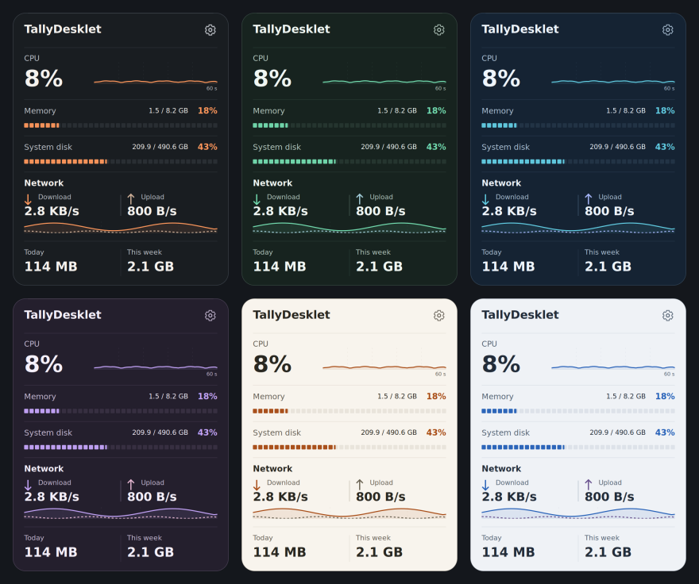
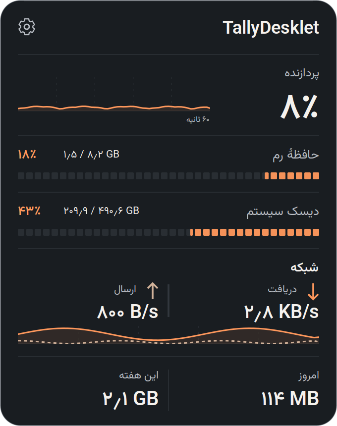
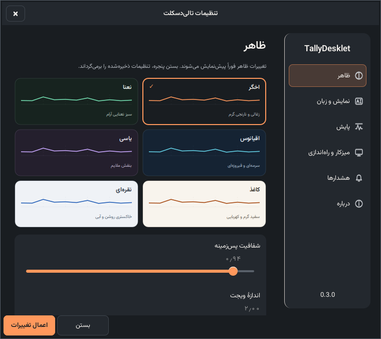
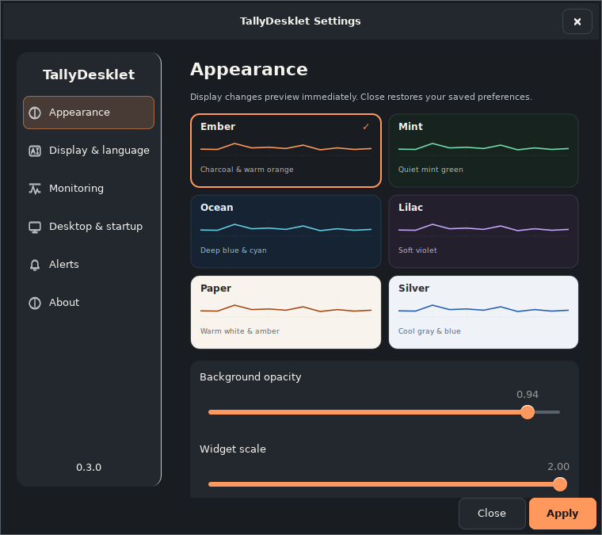

<p align="center">
  
</p>

<h1 align="center">TallyDesklet</h1>
<p align="center">A compact system monitor for your Linux desktop.</p>
<p align="center">
  <a href="https://github.com/saeedt20/TallyDesklet/releases/latest"></a>
  <a href="https://github.com/saeedt20/TallyDesklet/actions/workflows/ci.yml"></a>
  <a href="LICENSE"></a>
  
  
</p>
<p align="center">
  <strong>English</strong> · <a href="README.fa.md">فارسی</a>
</p>
<p align="center">
  <a href="https://github.com/saeedt20/TallyDesklet/releases/latest">Download</a> ·
  <a href="#install">Install</a> ·
  <a href="#build-from-source">Build from source</a> ·
  <a href="https://github.com/saeedt20/TallyDesklet/issues">Report an issue</a>
</p>

TallyDesklet puts CPU, memory, filesystem capacity, network speed, and daily and
weekly data usage on one small desktop card. Built with **Python 3, native GTK 3,
Cairo, and psutil** for **Xfce on X11**, it stays below ordinary windows by default
and keeps measurements and preferences on your computer.

The intended desktop is **Linux Mint 22.3 Xfce**. Other Linux desktops may run the
app with equivalent system dependencies, but positioning and stacking depend on
the window manager. The interface supports **English (LTR)** and **Persian (RTL)** with bundled
Vazirmatn fonts. Choose the language independently of the numerals in Settings.

## New in 0.3.1

The widget header now shows **TallyDesklet** and the settings gear. The CPU logo, “System” heading and “Live” dot/text are removed in both languages. English aligns the brand on the left; Persian aligns it on the right while keeping its Latin spelling. Metrics, graphs, themes, dimensions and preferences retain their existing behavior.

## See it in action

The default card measures **340 × 430 logical pixels**.
These previews show the **actual GTK interface rendered with fixed example data**.
Normal layout is 340 × 430 logical pixels; Compact is 320 × 342, and hidden
sections reduce height. The six themes apply to both the card and Settings.
They contain no user's desktop, live readings, hardware inventory, or personal paths.
The running app always collects real measurements.

<table>
  <tr><th>Dark theme</th><th>Light theme</th></tr>
  <tr>
    <td></td>
    <td></td>
  </tr>
</table>

<p></p>

<table><tr><th>Persian RTL widget</th><th>Persian RTL settings</th></tr>
<tr><td></td>
<td></td></tr></table>

<details>
<summary>Native settings: themes, language, sampling, desktop, alerts, and attribution</summary>



See [how the previews are generated](docs/examples/README.md). Live GUI-test
captures remain private local artifacts.

</details>

## Features

- **One compact card:** CPU, RAM, system disk, weekly/daily usage, and separate download/upload rates.
- **Readable histories:** 60-second CPU and dual network graphs, plus matching memory and disk capacity bars.
- **Six complete themes:** Ember, Mint, Ocean, Lilac, Paper and Silver, with palette thumbnails, opacity and a contrast-adjusted custom accent.
- **Reversible preview:** appearance/display settings preview immediately; Apply saves, Close/Discard restores saved preferences.
- **Bilingual layout:** English LTR, Persian RTL and independently selectable Auto/Latin/Persian numerals.
- **Your density:** Compact, per-section visibility, 0.75–2× size, and reduced motion.
- **Optional warnings:** sustained high memory/disk occupancy, native notifications off by default, 60-second dwell and ten-minute cooldown.
- **Flexible measurements:** decimal/binary units, 0.5/1/2/5-second sampling, an explicit network interface, and a configurable disk path.
- **Desktop controls:** header dragging, position lock/reset, optional always-on-top, and all-workspaces placement.
- **Native interaction:** accessible GTK settings, keyboard shortcuts, and a single application instance.
- **Your startup choice:** login startup is off by default and enabled only through Settings.
- **Local operation:** no account, telemetry, cloud service, or traffic generated to measure network speed.

## Install

Download **`tallydesklet_0.3.1-1_all.deb`** and **`SHA256SUMS`** from the
[latest release](https://github.com/saeedt20/TallyDesklet/releases/latest).
Run these commands in the download folder:

```bash
sha256sum -c SHA256SUMS
install -m 644 ./tallydesklet_0.3.1-1_all.deb /tmp/tallydesklet_0.3.1-1_all.deb
tallydesklet --quit
sudo apt install /tmp/tallydesklet_0.3.1-1_all.deb
tallydesklet
```

APT resolves the distribution-provided Python, GTK 3, Cairo, psutil, and iproute2
dependencies. Installation adds **TallyDesklet** to the System application menu;
it does not launch the app or enable login startup. Run it as your ordinary user.

The application requires **Python 3.10 or newer** and an **X11 desktop** for its
positioning and stacking controls. The commands here use Debian/Ubuntu-style
`apt` packages; a `.deb` does not guarantee compatibility with every distribution.

### Everyday use

Drag the unlocked header to move the card. The gear opens Settings. Right-click the card for Settings, Lock position,
Always on top, Reset position, and Quit. A repeat launch
opens Settings in the existing instance. Escape closes Settings.

| Command | Action |
| --- | --- |
| `tallydesklet` | Start the card; a repeat invocation opens Settings |
| `tallydesklet --settings` | Open Settings |
| `tallydesklet --reset-position` | Restore the upper-right position in the monitor's work area |
| `tallydesklet --version` | Print the version without opening a display |
| `tallydesklet --quit` | Close the running application |

Enable or disable **Start at login** in Settings. The option requires the stable
installed launcher at `/usr/bin/tallydesklet`; it is unavailable in a source-only
checkout. Autostart state comes from your user-scoped XDG desktop entry.

### New settings in 0.3

- **Appearance:** six theme tiles, opacity/scale sliders, Compact, reduced motion,
  optional custom accent and Restore theme colors.
- **Display & language:** English/Persian, Auto/Latin/Persian digits, SI/IEC units,
  and section visibility. Charts retain chronological left-to-right order.
- **Monitoring:** sample interval, literal interface ID, filesystem path chooser,
  and Saturday/Sunday/Monday week start. Changing week start recalculates retained
  daily buckets without changing their values.
- **Desktop & startup:** lock, top/below, all workspaces, explicit login startup,
  and immediate position reset. Narrow screens use named icon navigation.
- **Alerts:** optional memory/disk notifications, off by default. A reading must
  remain above its threshold for 60 seconds, with five-point rearm hysteresis and
  at most one attempt per metric per ten minutes. Missing data/resume gaps reset
  the sustained window. The program must be running and a session notification
  service must be available; desktop notification policy controls presentation.
- **About:** version, GitHub, issue reporting and MIT/OFL attribution.

Appearance and display preview without saving. Sampling, week definition,
notifications and login startup change only after **Apply**. Close or Escape asks
before discarding unsaved changes. Existing preferences, usage and startup choice
survive upgrade; legacy dark/light themes and chosen accent colors are preserved.
Fresh installs default to Ember. Font registration is process-private.

### Upgrade from Mint Meter

Quit the old app with `mint-meter --quit` before installing the new package.
APT replaces `mint-meter` with `tallydesklet`; the old command remains available
as a compatibility launcher.

On first launch, legacy `mint-meter/config.json` and `mint-meter/usage.json` are
copied from their XDG directories only when the corresponding TallyDesklet file
is absent. Original files remain intact, and newer TallyDesklet files take
priority. Existing opt-in login entries keep working; changing **Start at login**
replaces or removes the old entry only after your explicit choice.

## What the numbers mean

| Reading | Definition |
| --- | --- |
| CPU | Aggregate utilization across all cores; the initial sample is warm-up |
| RAM | Used memory is **total − available**; the bar uses the same ratio |
| System disk | Occupied / total capacity of the filesystem containing the selected path, `/` by default; refreshed every 10 seconds |
| Download / upload | Byte-counter differences divided by monotonic elapsed time, on one selected interface |
| Daily usage | Combined received + sent bytes observed while the app runs; resets at local midnight |
| Weekly usage | Combined usage for the calendar week; **Saturday, Sunday or Monday**, selected in Settings; Sunday preserved on upgrade |

Decimal units use powers of 1000 (`GB`, `MB/s`); binary units use 1024
(`GiB`, `MiB/s`). Disk capacity is storage occupancy, not disk I/O or a sum of
physical drives. Its tooltip separately reports space available to the user,
which may differ because of reserved filesystem blocks.

Usage totals survive normal restarts and remain available while offline. They
exclude traffic while the app is closed and ambiguous counter resets, reconnects,
or sampling gaps over 15 seconds. Initial periods may be partial. These totals
represent observed traffic, not an ISP bill or complete historical accounting.

<details>
<summary>Network selection, VPNs, unavailable readings, and persistence details</summary>

Automatic selection uses kernel route lookups without sending packets: IPv4 to
`1.1.1.1` first, IPv6 to `2606:4700:4700::1111` second. Kernel routing policy and
metrics choose the device; the lookup refreshes every 5 seconds. Loopback is
excluded. VPN logical routes, including split-default routes, are followed when
selected by the kernel. Select a physical interface manually to measure its
encapsulated traffic. Interfaces are never summed; destination-specific split
tunnels may use a different interface than these representative lookups.

An existing route does not prove internet connectivity. **Offline** means no
eligible active route/device; **Unavailable** means the device or its data could
not be read. A valid idle sample is `0 B/s`. Interface changes, resets, and gaps
over 15 seconds establish new baselines. Histories use Linux's suspend-aware
monotonic BOOTTIME clock.

A valid usage delta spanning midnight belongs to the later day. Switching
interfaces preserves accumulated totals and starts the new interface with a
fresh baseline. Only seven daily aggregates are retained. Usage is checkpointed
at most once per minute and flushed on normal exit; a forced kill or power loss
can lose up to the last minute. Corrupt history is preserved as
`usage.broken-<timestamp>.json` before tracking restarts. Read failures show
unavailable totals; save failures retain live totals and display a notice.

</details>

## Build from source

Install the runtime dependencies and use the distribution Python:

```bash
git clone https://github.com/saeedt20/TallyDesklet.git
cd TallyDesklet
sudo apt update
sudo apt install python3 python3-gi python3-gi-cairo python3-cairo \
  python3-psutil gir1.2-gtk-3.0 iproute2
./scripts/dev-run.sh
```

The launcher uses `/usr/bin/python3`. A regular pip virtual environment may lack
the system GTK bindings. Use `./scripts/dev-run.sh` in place of `tallydesklet` for
the same CLI options when running from a checkout.

Build the installable Debian package:

```bash
sudo apt install dpkg
./scripts/build-deb.sh
(cd dist && sha256sum -c SHA256SUMS)
```

The rootless build runs unit tests and creates
**`dist/tallydesklet_0.3.1-1_all.deb`** and **`dist/SHA256SUMS`**. Do not run the
build with sudo. TallyDesklet is interpreted Python, so no native compilation is
needed. GTK and psutil's native libraries remain system dependencies; nothing is
downloaded by the app at runtime.

<details>
<summary>Conventional Debian packaging</summary>

The same staging installer is used by debhelper:

```bash
sudo apt install build-essential debhelper dh-python
dpkg-buildpackage -us -uc -b
```

This places build artifacts in the parent directory, which must be writable.
See [release instructions](docs/RELEASING.md) for versioning and publication.

</details>

### Tests

```bash
PYTHONPATH=src /usr/bin/python3 -m unittest discover -s tests -v
./scripts/dev-run.sh --version
```

For isolated GTK/Xfwm checks:

```bash
sudo apt install xvfb xauth xfwm4 xdotool wmctrl x11-utils
./scripts/gui-check.sh
./scripts/gui-check.sh --composited
./scripts/gui-check.sh --hidpi
```

Version 0.3.0 adds **58 deterministic logic/data tests** and **14 native GTK/notification tests**.
Hosted CI on **Ubuntu 24.04** runs ordinary, composited and HiDPI Xfwm smoke checks,
the native tests, rootless packaging, lintian and conventional Debian packaging.
See [the validation record](docs/TESTING.md) for local scope and remaining hardware checks.

GUI checks use a private D-Bus session, isolated Xvfb display, and temporary XDG
preferences. Their captures and resource reports are excluded from Git and
package documentation. They do not prove real login startup, hardware hotplug,
or actual suspend/resume integration. See the [validation record and remaining
checks](docs/TESTING.md).

## Preferences and removal

| Data | Default location |
| --- | --- |
| Preferences | `~/.config/tallydesklet/config.json` |
| Bounded usage history | `~/.local/state/tallydesklet/usage.json` |
| Opt-in login entry | `~/.config/autostart/tallydesklet.desktop` |

`XDG_CONFIG_HOME` and `XDG_STATE_HOME` override these base directories. Saves are
atomic. Invalid preferences are preserved as `config.broken-<timestamp>.json`
before defaults load. Individual samples and graph histories are not stored.

Disable **Start at login** in Settings, then quit and remove the package:

```bash
tallydesklet --quit
sudo apt remove tallydesklet
```

Personal settings and usage history are preserved. If the app is already
uninstalled, remove only `tallydesklet.desktop` and, if upgrading,
`mint-meter.desktop` from `${XDG_CONFIG_HOME:-$HOME/.config}/autostart/`.

To erase saved data, optionally remove the `tallydesklet` directories under
`${XDG_CONFIG_HOME:-$HOME/.config}/` and `${XDG_STATE_HOME:-$HOME/.local/state}/`
after quitting. Legacy `mint-meter` directories are preserved backups; delete
them only if you no longer need them.

## Troubleshooting and compatibility

| Symptom | What to check |
| --- | --- |
| `No module named gi` or `cairo` | Install system dependencies and use `/usr/bin/python3` |
| Widget seems missing | Run `tallydesklet --reset-position`, then `tallydesklet --settings` |
| Disk is Unavailable | Select an existing, accessible path in Settings |
| Network is Offline or Unavailable | Check routing and select the intended interface |
| Background is opaque | Check desktop compositing; the opaque fallback is supported |
| Startup option is disabled in a checkout | Install the `.deb` to provide the stable launcher |

**X11 is the release target.** Wayland may display the card but ignore positioning,
stacking, dragging, or workspace hints; full Wayland widget integration is not
claimed. Window-manager hints are requests, not guarantees.

## Privacy

TallyDesklet reads local counters without an account, telemetry, cloud service,
or background web server. Configuration and bounded usage history stay in your
XDG directories. Review live screenshots before sharing: they can reveal machine
capacity, interface names, paths, and activity. Documentation previews use only
fixed example data.

## Contributing

[Bug reports](https://github.com/saeedt20/TallyDesklet/issues) and focused pull
requests are welcome. Include the app version, expected behavior, and steps to
reproduce; share only environment details you intend to make public.

Keep metric logic independent of GTK, histories bounded, and personal data out
of version control. Run unit tests and the package build for code changes;
run isolated GUI checks for interface changes. English and Persian documentation
improvements are welcome too.

See the [design notes](docs/DESIGN.md), [development instructions](AGENTS.md), and
[complete build specification](docs/BUILD_SPEC.md).

## License

Original application code and documentation are licensed under the
**[MIT license](LICENSE)**. Copyright © 2026 saeedt20.

TallyDesklet is an independent project, not an official Linux Mint product.
